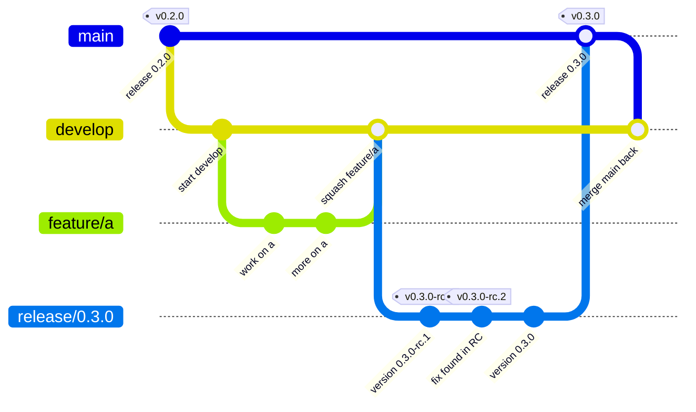

# Contributing

## Branches

| Branch | Starts from | Merges into | How | Tags |
|---|---|---|---|---|
| `feature/*`, `fix/*` | `develop` | `develop` | Squash merge | None |
| `develop` | `main`, once | Never merged directly | Release branches are cut from it | None |
| `release/x.y.z` | `develop` | `main` | Merge commit, never squash | `vx.y.z-rc.N` |
| `main` | | | Receives only release and hotfix merges | `vx.y.z` |
| `hotfix/*` | `main` | `main` and `develop` | Merge commit | `vx.y.z` (patch) |

- Every feature or issue gets its own branch from `develop`, for example `feature/plot-zoom` or `fix/help-panel-links`. Open a pull request against `develop`. Pull requests target `main` by default, so change the base branch.
- `main` only holds released code. The README on `main` describes the version people install.
- Commits follow [Conventional Commits](https://www.conventionalcommits.org). A squash merge's commit message is the pull request title, so write the title in that format too.

## Releasing

The console ([betteR](https://github.com/WahiduzzamanKhan/betteR)) and the VS Code extension ([vs_code_betteR](https://github.com/WahiduzzamanKhan/vs_code_betteR)) are released together, with the same version number. Do each step in both repos, console first.

1. Cut `release/x.y.z` from `develop`.
2. Set the version to `x.y.z-rc.1` (`package.json` here, `Cargo.toml` in the console), commit and push the tag `vx.y.z-rc.1`. If the release needs the new console, also raise `MIN_CONSOLE_VERSION` in `src/compat.ts`. Tags with `-rc` are published as GitHub pre-releases, so `releases/latest` doesn't pick them up.
3. Test the release candidate. Fix problems on the release branch and tag `rc.2`, `rc.3` and so on.
4. Set the version to `x.y.z`, merge the release branch into `main` with a merge commit, and tag `vx.y.z` on `main`.
5. Merge `main` back into `develop`, then delete the release branch.

Don't squash the release merge. `main` and `develop` have to share history, or every later release ends in conflicts.

### Hotfixes

For an urgent fix to a released version, branch `hotfix/*` from `main`, bump the patch version, merge it into `main`, tag `vx.y.z`, then merge it into `develop` as well.
